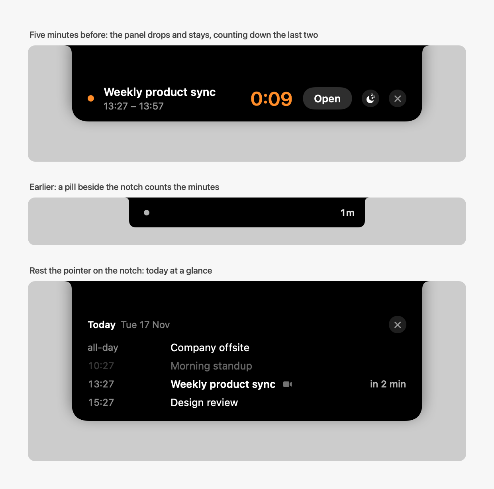

# Kyo

A meeting reminder for the Mac that lives in the notch.

No menu bar icon and no calendar window. When a meeting is close, a black panel
grows out of the notch, counts down, and gives you one button to join the call.



## What it does

| When | What you see |
|---|---|
| 1 hour before | The panel drops for a few seconds, then retracts |
| 15 minutes before | A small pill beside the notch with the minutes to go |
| 5 minutes before | The panel drops and stays, with an **Open** button for the call |
| Last 2 minutes | A live countdown |
| At the start | Turns green |
| 1 minute late, not joined | Turns red, pulses, and plays one sound |

- **Open** joins the call. Standard Zoom and Teams join links open in their
  own apps when installed; Google Meet opens as the Google account that was
  invited. A link to any other site names that site on the button, and is
  only offered for meetings you made or accepted, since anyone can send an
  invitation.
- **Rest the pointer on the notch** to see everything on today.
- **In a call already?** While a microphone is in use the reminder stays a
  quiet pill and never sounds.
- **Snooze** or dismiss from the panel. Right-click it for settings: lead time,
  snooze length, sound, which calendars count, and whether invitations you
  have not answered are ignored.
- Works on any display: with no notch, the panel drops from the top centre of
  whichever screen the pointer is on.

Events come from the calendars already set up in macOS (System Settings →
Internet Accounts), so iCloud, Google and Exchange work without signing in to
anything. Only the next meeting alerts. All-day events are listed but never
alert; declined and cancelled events are ignored. Invitations you have not
answered yet do alert.

## Install

Needs macOS 14 or later, on Apple silicon or Intel.

### Download

1. Get `Kyo-x.y.z.dmg` from the [latest release](../../releases/latest).
2. Open it and drag Kyo into Applications.
3. Open Kyo. macOS refuses the first time, because the app is not notarized
   by Apple. Go to System Settings → Privacy & Security, scroll down to the
   message about Kyo, and choose **Open Anyway**. This is needed once.
4. Allow calendar access when asked.

Kyo then starts at login; turn that off from the right-click menu.

### Build from source

You need Xcode (Swift 6).

```bash
git clone https://github.com/YucaApp/kyo-app.git
cd kyo-app
Scripts/make-signing-cert.sh   # once per Mac, optional but recommended
Scripts/install.sh             # builds, copies to /Applications, starts it
```

**About signing.** macOS ties the calendar permission to the app's signature.
`make-signing-cert.sh` creates a self-signed certificate in your login keychain
so the permission survives rebuilds. Without it the app is ad-hoc signed and
macOS asks again after every build. An Apple Development or Developer ID
certificate is used instead if you have one. The self-signed route is a
convenience with a cost: other software running as you could use that
certificate to sign itself as Kyo, so skip it if that matters to you.

## Privacy

Kyo runs entirely on your Mac. It makes no network requests and collects
nothing.

- **Calendar**: reads your events to know when meetings start. It never
  changes them.
- **Pointer**: watches where the pointer is, only to tell when it rests on the
  notch. It does not see clicks elsewhere or anything you type.
- **Microphone**: asks macOS whether a microphone is in use, to stay quiet
  during calls. It never opens the microphone or hears any audio, which is why
  macOS does not ask for microphone permission. This can be switched off.
- **Links**: joining opens the meeting's own link in your browser or call app.
  For Google Meet, the address you were invited at is added to the link so
  Google picks the right account.
- **Stored on your Mac**: only your settings (lead time, snooze, toggles, and
  which calendars are hidden). No copy of your events is kept.

## Development

```bash
swift test                                   # timing, labels, links, day list
Scripts/build-app.sh                         # build/Kyo.app, without installing
open build/Kyo.app --args --demo             # a made-up day, every phase in 90 seconds
open build/Kyo.app --args --demo --busy      # the same, as if you were in a call
Scripts/release.sh                           # dist/Kyo-<version>.dmg for a release
```

Add `--snapshot <folder>` to a demo run to write a picture of the panel each
second, plus a log of clicks and hovers. The screenshot above was made this
way. It only works with `--demo`, so real meeting titles are never written out.

- `Sources/KyoCore`: the rules, with no interface code. When each phase begins
  (`ReminderSchedule`), what the labels say (`TimeLabel`), the day's list
  (`Agenda`), and finding and rewriting call links (`MeetingLinkFinder`,
  `NativeMeetingLink`, `InviteAccount`). All of it is covered by tests.
- `Sources/Kyo`: the app. `ReminderController` turns the clock, the calendar
  and the pointer into what the panel shows; `NotchPanel` and `NotchView` draw
  it; `MeetingSource` reads EventKit.
- `Support`: `Info.plist` and the icon. After changing `AppIcon-source.png`,
  run `swift Scripts/make-icon.swift Support/AppIcon-source.png Support/Kyo.icns`.

## Licence

MIT. See [LICENSE](LICENSE).
